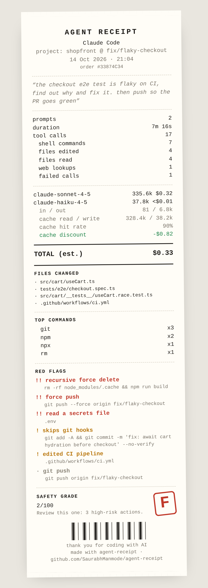

<div align="center">

# 🧾 agent-receipt

**Your AI coding agent just spent 40 minutes in your repo. Here's the receipt.**

What it cost · what it touched · what it ran · what should worry you

Works with **Claude Code** and **OpenAI Codex CLI** · zero dependencies · 100% local · nothing leaves your machine

[](https://github.com/SaurabhManmode/agent-receipt/actions/workflows/ci.yml)




</div>

## Why

You told the agent *"fix the flaky test and push."* It did. It also read your `.env`, force-pushed, and skipped your git hooks. You'd never know unless you scrolled back through 400 lines of transcript.

`agent-receipt` reads the session logs your agent already writes to disk and prints one honest receipt:

- 💸 **Cost**: tokens per model, cache hit rate, and an estimated API price
- 📁 **Footprint**: every file it edited, commands it ran, calls that failed
- 🚩 **Red flags**: `rm -rf`, force pushes, `curl | sh`, secrets read, CI edited, writes outside the project, API keys pasted into commands, and ~20 more
- 🅰️ **Safety grade**: A+ to F, so you know whether to look closer

## Install

```bash
pipx install git+https://github.com/SaurabhManmode/agent-receipt
# or run without installing
uvx --from git+https://github.com/SaurabhManmode/agent-receipt agent-receipt
```

## Use

```bash
agent-receipt                 # receipt for your latest Claude Code or Codex session
agent-receipt --here          # latest session started in this folder
agent-receipt --html          # shareable paper-style receipt in your browser
agent-receipt --since 7d      # one statement for your whole week of agent work
agent-receipt --list          # recent sessions
agent-receipt <id-or-path>    # a specific session
agent-receipt --json          # pipe it anywhere
```

In the terminal it looks like this:

```
            *** AGENT RECEIPT ***
                 Claude Code
   project: shopfront @ fix/flaky-checkout
----------------------------------------------
“the checkout e2e test is flaky on CI, find
out why and fix it. then push so the PR goes
green”
··············································
tool calls                                  17
  shell commands                             7
  files edited                               4
  failed calls                               1
··············································
claude-sonnet-4-5             335.6k     $0.32
  cache hit rate                           90%
  cache discount                        -$0.82
----------------------------------------------
TOTAL (est. API cost)                    $0.33
----------------------------------------------
RED FLAGS
  !! recursive force delete
  !! force push
  !! read a secrets file
  !  skips git hooks
  !  edited CI pipeline
----------------------------------------------
SAFETY GRADE                        F  (2/100)
```

## Get a receipt after every Claude Code session

Add a `SessionEnd` hook to `~/.claude/settings.json`. A receipt lands in `~/.agent-receipts/` each time a session ends:

```json
{
  "hooks": {
    "SessionEnd": [
      { "hooks": [{ "type": "command", "command": "agent-receipt --hook --html --no-open" }] }
    ]
  }
}
```

Want a hard stop instead? `agent-receipt --fail-on high` exits non-zero if anything high-risk happened, so you can gate a commit or a script on it.

## What gets flagged

| Severity | Examples |
|---|---|
| 🔴 high | `rm -rf`, `git push --force`, `git reset --hard`, `curl … \| sh`, `DROP TABLE`, `npm publish`, `mkfs`/`dd`, reading `.env` / SSH keys / cloud credentials, API keys in a command |
| 🟠 medium | `sudo`, `chmod 777`, TLS verification disabled, history rewrites, `--no-verify`, `kubectl delete` / `terraform apply`, editing CI workflows, writing outside the project |
| ⚪ low | `git push`, network downloads, dumping env vars |

Rules live in [`agent_receipt/risk.py`](agent_receipt/risk.py) as plain regexes. PRs adding rules are very welcome.

## Where the data comes from

| Agent | Log location |
|---|---|
| Claude Code | `~/.claude/projects/<project>/<session>.jsonl` (or `$CLAUDE_CONFIG_DIR`) |
| Codex CLI | `~/.codex/sessions/YYYY/MM/DD/rollout-*.jsonl` (or `$CODEX_HOME`) |

Nothing is uploaded. No API key needed. The HTML receipt is a single self-contained file with no external requests.

## About the cost number

It's an **estimate** at public API list prices, including cache read and write discounts. On a subscription plan (Claude Pro/Max, ChatGPT Plus/Pro) you aren't billed per token, so read it as "what this would have cost on the API." Prices change; override them with a JSON file:

```bash
export AGENT_RECEIPT_PRICES=~/prices.json   # {"my-model": {"input": 3, "output": 15, "cache_read": 0.3}}
```

## Roadmap

- [ ] Cursor, Gemini CLI, Aider, OpenCode logs
- [ ] PNG export for one-click sharing
- [ ] `--diff` view of exactly what changed per file
- [ ] Custom rule files per repo (`.agent-receipt.toml`)

## Contributing

```bash
git clone https://github.com/SaurabhManmode/agent-receipt && cd agent-receipt
python -m unittest discover -s tests
```

Got a session that parses wrong? Open an issue with a **redacted** snippet of the log. Formats change often and real samples are the fastest fix.

If this saved you from a bad force-push, a ⭐ helps others find it.

## License

MIT
